# @oakoliver/ntcharts

Terminal charts for TypeScript: canvas, bar, line, streaming, time series, wave, sparkline and heatmap charts, plus candlesticks and braille plots. A port of [NimbleMarkets/ntcharts](https://github.com/NimbleMarkets/ntcharts) **v2.9.0**, the release that targets Bubble Tea v2, for [@oakoliver/bubbletea](https://github.com/oakoliver/bubbletea). Every chart also renders to a plain string, so you can print it from any CLI or put it in an Ink app. See [CHANGELOG.md](CHANGELOG.md).


**Read the article:** [Getting Started with ntcharts in TypeScript](https://engineering.oakoliver.com/articles/getting-started-ntcharts-terminal-charts-typescript) · [Porting ntcharts from Go to TypeScript](https://engineering.oakoliver.com/articles/porting-go-ntcharts-to-typescript-byte-exact-terminal-charts)

## Larger Examples

Two full-screen programs in [`examples/`](examples/) combine several chart types. To run them, see [Running the examples](#running-the-examples).

### market.ts: a trading dashboard on invented data

The recording above. Eight made-up tickers in four sectors follow a random walk. The screen has a watchlist with sparklines, one-minute candles of the selected ticker (time series chart), a volume panel drawn on a plain canvas and aligned with the candles through `candleColumn()`, and a heatmap of sector moves in 10-minute buckets. Keys: ↑/↓ ticker, ←/→ scroll back in time, `end` back to live, `+`/`-` or the mouse wheel zoom, `b` line or block candles, `space` pause, a click on a watchlist row selects it. Every number is invented, and the header says so; `--demo` makes it the same market on every run.

### netmon.ts: a latency monitor


Once a second it times a TCP connection to five public hosts (port 443, nothing is sent) and keeps 15 minutes of history: a host table with last, average, 95th percentile and loss, a horizontal bar chart of the 95th percentile, every host on one time series chart with 1, 5 or 15 minute windows and a log or linear Y axis, the selected host as a streaming line with its loss on a second Y axis, and a heatmap of its latency distribution over time. `--demo` uses invented hosts and a seeded PRNG at 4× speed, as in the recording, and sends nothing over the network.

## Install

```bash
npm install @oakoliver/ntcharts @oakoliver/lipgloss @oakoliver/bubbles @oakoliver/bubbletea
```

Lip Gloss, Bubbles and Bubble Tea are peer dependencies: the charts style cells with Lip Gloss, their key maps are Bubbles key bindings, and they take Bubble Tea messages. `@oakoliver/bubblezone` is an optional peer, needed only for mouse support. There are no other dependencies.

## Charts as strings

A chart is built, fed data and drawn without a Bubble Tea program. `view()` returns the chart as a string with ANSI styles, so it works anywhere a string does.

```typescript
import * as tslc from '@oakoliver/ntcharts/linechart/timeserieslinechart';

const chart = tslc.New(41, 10);
const day = 24 * 60 * 60 * 1000;
const start = Date.UTC(2026, 10, 1);
[0, 4, 8, 10, 8, 4, 0, -4, -8, -10, -8, -4, 0].forEach((v, i) => {
  chart.push({ time: new Date(start + i * day), value: v });
});
chart.drawBraille();
console.log(chart.view());
```

```
 10│      ⣀⠤⠒⠉⠒⠤⡀                        
   │    ⡠⠊      ⠈⠢⡀                      
  5│  ⡠⠊          ⠈⠢⡀                    
   │⡠⠊              ⠈⠑⢄                 ⢀
  0│                   ⠑⡄              ⡔⠁
   │                    ⠈⠢⡀          ⡠⠊  
 -5│                      ⠈⠢⡀      ⡠⠊    
   │                        ⠈⠑⠢⢄⡠⠔⠊      
-10└─────────────────────────────────────
   '26 11/01   11/04   11/07   11/10     
```

```typescript
import * as streamlinechart from '@oakoliver/ntcharts/linechart/streamlinechart';

const slc = streamlinechart.New(13, 10);
for (const v of [4, 6, 8, 10, 8, 6, 4, 2, 0, 2, 4]) slc.push(v);
slc.draw();
console.log(slc.view());
```

```
  │  ││      
 8│ ╭╯╰╮     
  │ │  │     
 6│╭╯  ╰╮    
  ││    │    
 4├╯    ╰╮  ╭
  │      │  │
 2│      ╰╮╭╯
  │       ││ 
 0│       ╰╯ 
```

```typescript
import * as wavelinechart from '@oakoliver/ntcharts/linechart/wavelinechart';

const wlc = wavelinechart.New(12, 10, wavelinechart.WithYRange(-3, 3));
wlc.plot({ x: 1, y: 2 });
wlc.plot({ x: 3, y: -2 });
wlc.plot({ x: 5, y: 2 });
wlc.plot({ x: 7, y: -2 });
wlc.plot({ x: 9, y: 2 });
wlc.draw();
console.log(wlc.view());
```

```
 3│         
  │╭╮  ╭╮  ╭
 2│││  ││  │
  │││  ││  │
 0├╯╰╮╭╯╰╮╭╯
  │  ││  ││ 
-2│  ││  ││ 
  │  ╰╯  ╰╯ 
-3└─────────
  0 2 4 6 9 
```

Either axis of a line chart can be logarithmic:

```typescript
import { ScaleLog } from '@oakoliver/ntcharts/linechart';
import * as wavelinechart from '@oakoliver/ntcharts/linechart/wavelinechart';

const wlc = wavelinechart.New(24, 10,
  wavelinechart.WithYScale(ScaleLog),
  wavelinechart.WithXYRange(0, 5, 1, 10000));
[3, 40, 500, 6000].forEach((v, i) => wlc.plot({ x: i + 1, y: v }));
wlc.draw();
console.log(wlc.view());
```

```
10000│             ╭╮   
     │             ││   
 1000│             ││   
     │          ╭╮ ││   
  100│          ││ ││   
     │      ╭╮  ││ ││   
   10│      ││  ││ ││   
     │   ╭╮ ││  ││ ││   
    1└───┴┴─┴┴──┴┴─┴┴───
     0 1   2   3   4  5 
```

The colored ones, as a terminal shows them:

```typescript
import { newStyle } from '@oakoliver/lipgloss';
import * as canvas from '@oakoliver/ntcharts/canvas';

const c = canvas.New(5, 2);
c.setLinesWithStyle(['hello', 'world'], newStyle().foreground(6)); // cyan
console.log(c.view());
```

```typescript
import { newStyle } from '@oakoliver/lipgloss';
import * as barchart from '@oakoliver/ntcharts/barchart';

const bc = barchart.New(11, 10);
bc.pushAll([
  { label: 'A', values: [{ name: 'Item1', value: 21.2, style: newStyle().foreground(10) }] }, // green
  { label: 'B', values: [{ name: 'Item1', value: 15.2, style: newStyle().foreground(9) }] }, // red
]);
bc.draw();
console.log(bc.view());
```

```typescript
import * as heatmap from '@oakoliver/ntcharts/heatmap';

// visits per day and time of day; each value fills one cell of the grid
const days = ['Mon', 'Tue', 'Wed'];
const hours = ['00h', '06h', '12h', '18h'];
const visits = [
  [2, 9, 14, 6],
  [1, 11, 16, 8],
  [3, 7, 12, 10],
];
const hm = heatmap.New(24, 8, heatmap.WithValueRange(0, 16), heatmap.WithCellSize(1, 1));
hm.setXLabels(hours);
hm.setYLabels([...days].reverse()); // rows count up from the bottom
visits.forEach((row, d) => row.forEach((v, h) => hm.push(heatmap.NewHeatPointInt(h, days.length - 1 - d, v))));
hm.draw();
console.log(hm.view());
```

```typescript
import * as sparkline from '@oakoliver/ntcharts/sparkline';

const sl = sparkline.New(10, 3);
sl.pushAll([7.81, 3.82, 8.39, 2.06, 4.19, 4.74, 6.21, 4.41, 9.87, 3.53]);
sl.draw();
console.log(sl.view());
```

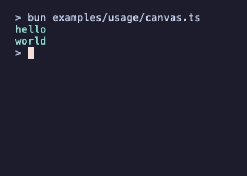 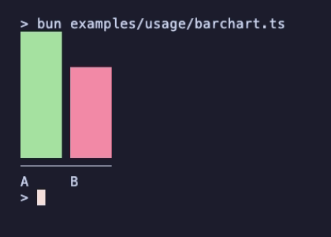 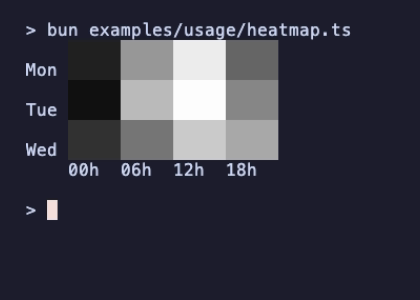 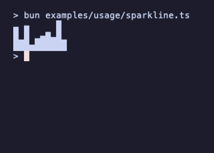

These snippets are [`examples/usage/`](examples/usage/). A test runs each of them and compares what it prints with the output of the same code written against upstream Go ntcharts.

### In Ink

Put `view()` in a `<Text>`. Ink's tokenizer, `@alcalzone/ansi-tokenize`, counts the short reset `ESC[m` that Lip Gloss writes as three visible characters in versions below 0.2.2, so inside a `<Box>` with a border the widths go wrong and the colors can leak. Ink 5.x and Ink 6.0 to 6.2.0 depend on `^0.1.3` and are affected; Ink 6.2.3 and later (and Ink 7 and 8) install 0.2.2 or later and are not. Upgrading Ink is the better fix. If you cannot, or a lockfile pins the tokenizer below 0.2.2, spell the reset `ESC[0m` as in the `replaceAll` below, which is otherwise not needed:

```tsx
import React, { useEffect, useState } from 'react';
import { render, Box, Text } from 'ink';
import { newStyle } from '@oakoliver/lipgloss';
import * as sparkline from '@oakoliver/ntcharts/sparkline';

const chart = sparkline.New(30, 4, sparkline.WithStyle(newStyle().foreground('#a6e3a1')));

function App() {
  const [, setTick] = useState(0);
  useEffect(() => {
    const id = setInterval(() => {
      chart.push(Math.random() * 100);
      chart.draw();
      setTick((t) => t + 1);
    }, 100);
    return () => clearInterval(id);
  }, []);
  return (
    <Box borderStyle="round" flexDirection="column">
      <Text>requests / s</Text>
      <Text>{chart.view().replaceAll('\x1b[m', '\x1b[0m')}</Text>
    </Box>
  );
}

render(<App />);
```

## In a Bubble Tea program

Charts are Bubble Tea components, like the ones in Bubbles: pass them messages in your `update`, put their `view()` in yours. A focused chart handles its own keys and mouse wheel; with a [bubblezone](https://github.com/oakoliver/bubblezone) manager it also handles clicks and drags.

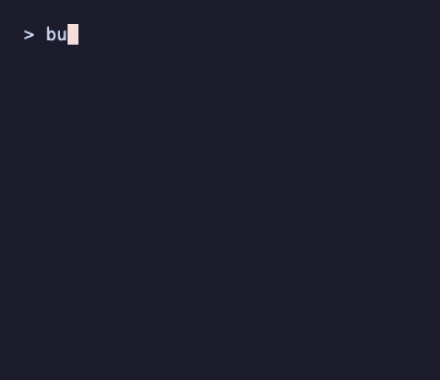

```typescript
import { NewProgram, NewView, Quit, MouseMode, type Cmd, type Model, type Msg, type View } from '@oakoliver/bubbletea';
import { newStyle, normalBorder } from '@oakoliver/lipgloss';
import * as zone from '@oakoliver/bubblezone';
import * as tslc from '@oakoliver/ntcharts/linechart/timeserieslinechart';

class Quickstart implements Model {
  constructor(public chart: tslc.Model, public zm: zone.Manager) {}

  init(): Cmd {
    return null;
  }

  update(msg: Msg): [Model, Cmd] {
    if (msg?._tag === 'KeyPressMsg' && ['q', 'ctrl+c'].includes(msg.toString())) return [this, Quit];
    // forward the message to the chart, then draw all data sets with braille runes
    this.chart.update(msg);
    this.chart.drawBrailleAll();
    return [this, null];
  }

  view(): View {
    // call the zone manager's scan() at the root model
    const v = NewView(this.zm.scan(newStyle().borderStyle(normalBorder()).borderForeground(63).render(this.chart.view())));
    v.altScreen = true;
    v.mouseMode = MouseMode.CellMotion;
    return v;
  }
}

const chart = tslc.New(30, 12);
const day = 24 * 60 * 60 * 1000;
const start = Date.now();
[0, 2, 4, 6, 8, 10, 8, 6, 4, 2, 0].forEach((v, i) => chart.push({ time: new Date(start + i * day), value: v }));
chart.setStyle(newStyle().foreground(9)); // red
[10, 8, 6, 4, 2, 0, 2, 4, 6, 8, 10].forEach((v, i) => chart.pushDataSet('dataSet2', { time: new Date(start + i * day), value: v }));
chart.setDataSetStyle('dataSet2', newStyle().foreground(10)); // green

const zm = zone.New();
chart.setZoneManager(zm);
chart.focus(); // only a focused chart handles keyboard and mouse messages
chart.drawBrailleAll();

await NewProgram(new Quickstart(chart, zm)).run();
```

Mouse support needs three things: a manager from `zone.New()` given to the chart (`setZoneManager` or the `WithZoneManager` option), mouse reporting turned on in the view (`mouseMode`), and the root view wrapped in `zm.scan()`. The charts do not import `@oakoliver/bubblezone`; they accept any object with its `newPrefix`, `mark` and `get` methods.

Zone IDs: by default a chart takes its zone ID from the manager's `newPrefix()`, which counts across the whole process, so the ID differs between programs and sessions. As in upstream, the ID is only set when you give the chart a manager. To fix it, pass `WithZoneID('station/map')` (or call `setZoneID`), available on `canvas`, `barchart`, `linechart`, `streamlinechart`, `timeserieslinechart` and `wavelinechart`; it works before or after `WithZoneManager`. The ID is used as is, so it must be unique among the zones of one manager. `heatmap` and `sparkline` do not mark zones.

### Reusing a sparkline

With `autoMaxValue` (the default) a sparkline's maximum only grows, and, as upstream, `clear()` keeps it, so a sparkline reused for new data keeps the old scale. Call `resetMax()` to go back to the maximum last set with `setMax()` or `WithMaxValue()` (1 if none was): `sl.clear(); sl.resetMax();`.

## Chart types

One small program per chart type, each a port of an upstream example. Keys and details are in [`examples/README.md`](examples/README.md).

| | |
|---|---|
| **canvas** ([source](examples/canvas.ts)): a 2D grid of styled runes, the base of every chart. Viewports, cursors, mouse drag.<br>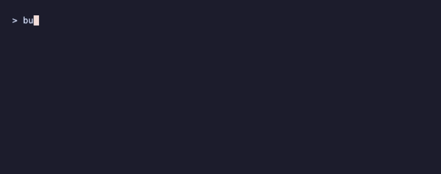 | **graph** ([source](examples/graph.ts)): the drawing helpers: lines, circles, braille, columns, rows, candlesticks.<br>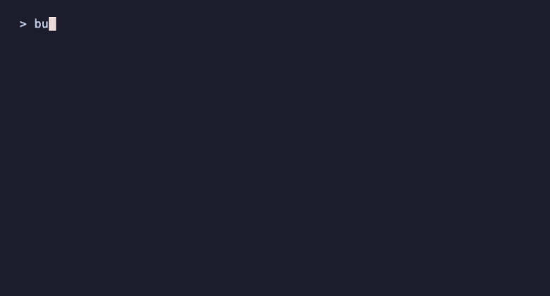 |
| **barchart** ([source](examples/barchart.ts)): vertical or horizontal bars, stacked values, negative values.<br>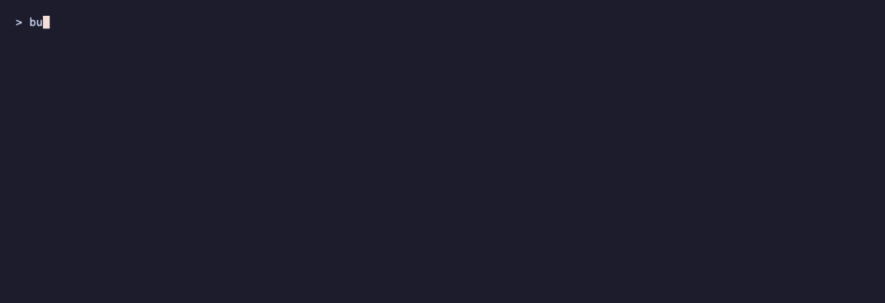 | **sparkline** ([source](examples/sparkline.ts)): columns, braille and quadrant blocks.<br>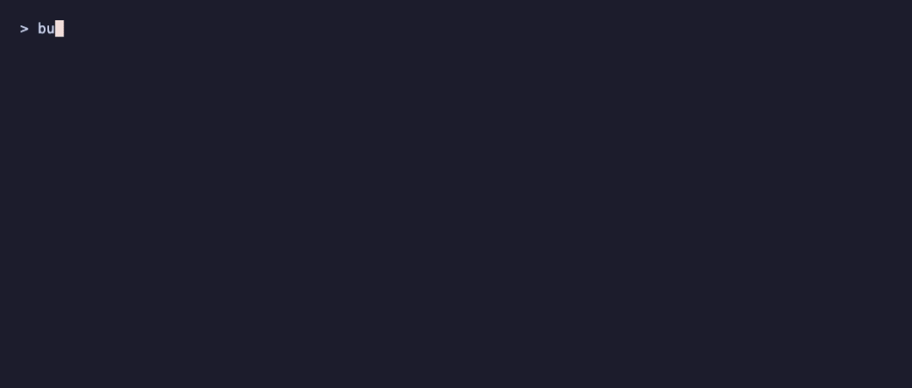 |
| **heatmap** ([source](examples/heatmap.ts)): values on a color scale, as cells with labels or as points.<br>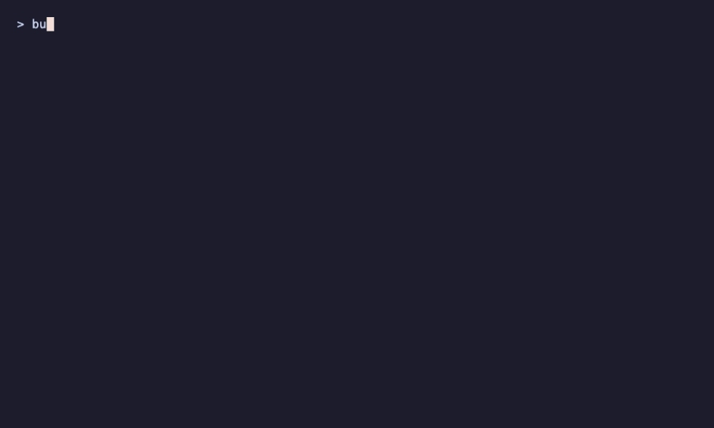 | **linechart** ([source](examples/linechart.ts)): lines, circles and scatter points on (X,Y) axes, zoom and move.<br>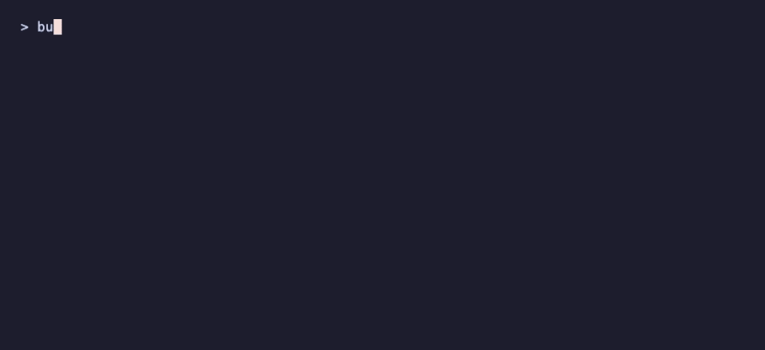 |
| **streamlinechart** ([source](examples/streamlinechart.ts)): values stream in from the right; a second Y axis.<br> | **timeserieslinechart** ([source](examples/timeserieslinechart.ts)): time on the X axis; lines, braille, candlesticks.<br>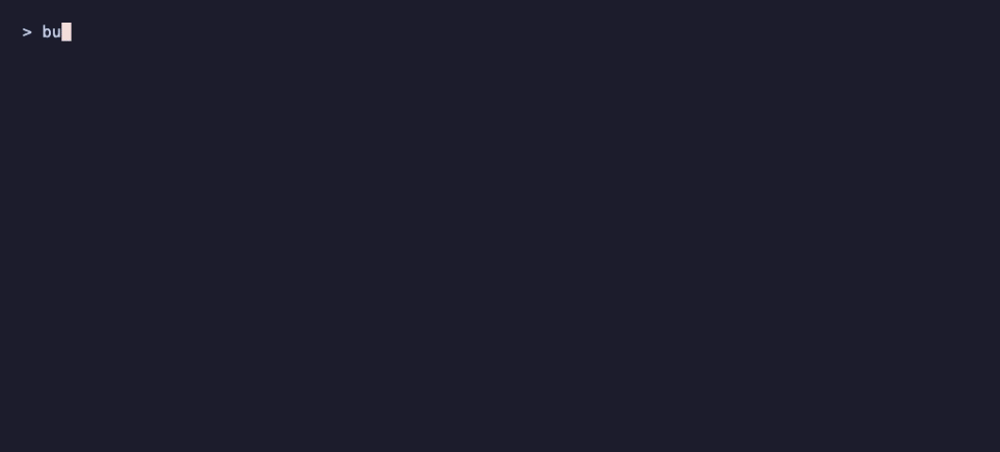 |
| **wavelinechart** ([source](examples/wavelinechart.ts)): one value per column, joined as a wave.<br>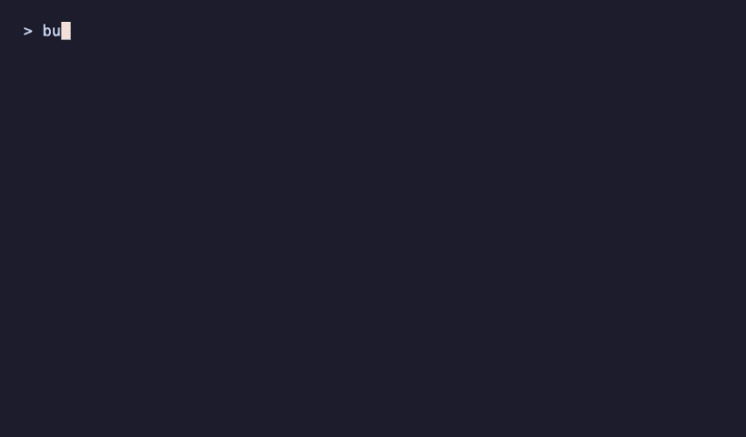 | **spec** ([source](examples/spec.ts)): a chart described as JSON, built into one of the charts above and printed. `bun examples/spec.ts examples/specs/ohlc-volume.json` |

The recordings are made with [@oakoliver/vhs](https://github.com/oakoliver/vhs) from the tapes in [`assets/tapes/`](assets/tapes/).

### Running the examples

The examples import this repository's source; the sibling ports are its dev dependencies.

```bash
git clone https://github.com/oakoliver/ntcharts && cd ntcharts
bun install
bun examples/market.ts --demo     # also: netmon.ts [--demo], quickstart.ts, canvas.ts, graph.ts, barchart.ts, ...
```

`bun install` expects a checkout of [bubblezone](https://github.com/oakoliver/bubblezone) next to this one (`file:../bubblezone`) until it is on npm.

## Charts from JSON

The `spec` package describes a chart as data: type, axes, series, options, theme. `Build()` turns a spec into one of the charts above. Specs use upstream's JSON field names, so a spec written for the Go library works unchanged:

```typescript
import { readFileSync } from 'node:fs';
import * as spec from '@oakoliver/ntcharts/spec';

const chart = spec.Build(JSON.parse(readFileSync('examples/specs/stacked-bar.json', 'utf8')));
console.log(chart.view());
```

`Build()` throws an `Error` with Go's error text where Go returns an error. It supports bar (stacked, horizontal), line, scatter, time series, OHLC with an optional volume panel, heatmap, sparkline, categorical and bar/line combo charts, dual Y axes and log scales. [`examples/specs/`](examples/specs/) has three samples.

## Packages

Each Go package is a subpath export and a namespace of the root export:

| Go package | Import | |
|---|---|---|
| `canvas` | `@oakoliver/ntcharts/canvas` | `Model`, `New`, points and cells, viewport, key map and update handler |
| `canvas/runes` | `@oakoliver/ntcharts/canvas/runes` | box-drawing, block, braille and candlestick runes and how they combine |
| `canvas/buffer` | `@oakoliver/ntcharts/canvas/buffer` | scaled data buffers and the ring buffer the streaming charts use |
| `canvas/graph` | `@oakoliver/ntcharts/canvas/graph` | axes, lines, braille grids, columns, rows, circles, candlesticks |
| `barchart` | `@oakoliver/ntcharts/barchart` | bar chart |
| `sparkline` | `@oakoliver/ntcharts/sparkline` | sparkline |
| `heatmap` | `@oakoliver/ntcharts/heatmap` | heatmap |
| `linechart` | `@oakoliver/ntcharts/linechart` | line chart, axes, scales (`ScaleLinear`, `ScaleLog`), second Y axis |
| `linechart/streamlinechart` | `@oakoliver/ntcharts/linechart/streamlinechart` | streaming line chart |
| `linechart/timeserieslinechart` | `@oakoliver/ntcharts/linechart/timeserieslinechart` | time series chart, candlesticks |
| `linechart/wavelinechart` | `@oakoliver/ntcharts/linechart/wavelinechart` | wave line chart |
| `spec` | `@oakoliver/ntcharts/spec` | charts described as JSON |

```typescript
import { canvas, barchart, timeserieslinechart } from '@oakoliver/ntcharts';
import * as graph from '@oakoliver/ntcharts/canvas/graph';
```

Names follow the Go API: package-level functions, options and constants keep their Go names (`barchart.New`, `WithHorizontalBars`, `graph.DrawColumns`, `runes.FullBlock`); methods and fields are camel case (`m.view()`, `m.pushAll()`, `m.viewWidth`). A rune is a one-character string. Points are `{ x, y }` objects. Times are `Date`s.

## Parity with upstream

The port follows ntcharts v2.9.0 (Bubble Tea v2 branch, tag `v2.9.0`), and its output is compared with the Go library itself:

- **Upstream tests.** Every `_test.go` file of the ported packages is ported to `bun test`, with upstream's golden files.
- **Parity scenarios.** [`tests/parity/go`](tests/parity/go) is a Go program that renders scenarios with upstream ntcharts and writes their output to `tests/parity/goldens.json`; [`tests/parity.test.ts`](tests/parity.test.ts) renders the same scenarios with the port and compares them byte for byte, styles included. The comparison normalises one thing: Go's Lip Gloss writes `ESC[1;7;44m` where the TypeScript Lip Gloss writes `ESC[1mESC[7mESC[44m`; adjacent style sequences are merged before comparing.
- **Go's float arithmetic.** Matching byte for byte needs Go's floating point: on arm64 Go compiles `a*b + c` to one fused multiply-add, and Go's `math.Log`, `Log10`, `Exp` and `Pow` differ from JavaScript's `Math` in the last bit for many inputs. Those last bits move tick labels and scaled points from one cell to the next. `src/internal/gomath.ts` has an exact `fma` and ports of Go's algorithms, used where upstream's results reach the screen. The goldens are generated on arm64 (an Apple Mac); on amd64, Go does not fuse, so a few labels could differ by one cell from what Go prints there.

`bun test` runs 872 tests: 505 from upstream's 294 Go tests and examples in 43 test files (table tests become one test per case), 342 parity scenarios rendered by Go and by the port (canvas 33, graph 69, runes 8, barchart 29, sparkline 21, heatmap 28, linechart 27, streamlinechart 19, timeserieslinechart 23, wavelinechart 16, spec 61, README snippets 8), plus checks that the README samples are the tested programs, that clicks and drags work through `@oakoliver/bubblezone`, and 19 tests of the additions in 1.1.0 (`resetMax()` and `WithZoneID`). All pass.

What differs from Go, on purpose:

- **Mutable models.** Go models are values: `m, cmd = m.Update(msg)` returns a copy. Here `update(msg)` changes the chart and returns it. `clone()` gives you a copy where you need one.
- **Messages by tag.** The charts recognise Bubble Tea messages by their `_tag` (`'KeyPressMsg'`, `'MouseWheelMsg'`, …), not by class, and never import Bubble Tea at runtime.
- **No WASM yielding.** Upstream's heatmap yields to the Go WASM event loop while it draws; JavaScript drawing is synchronous, so there is nothing to port.

### Not ported

- **`picture`, `picture/heatpicture`, `picture/pictureurl`, `picture/chartpicture`, `internal/kittyshm`.** Images in the terminal, through the Kitty graphics protocol or half-block glyphs. They rely on Go's image decoders (PNG, JPEG, GIF, WebP through `golang.org/x/image`), which Node has no dependency-free equivalent of, on POSIX shared memory for Kitty transfers, and `chartpicture` renders through the Go library go-analyze/charts. The glyph renderer is also under the MPL-2.0, not MIT. A TypeScript version would be a separate package that takes decoded pixels.
- **`spec/echarts`.** It turns a spec into a go-echarts web chart, a Go library.
- **`cmd/` and `web/`.** Upstream's demo programs, probes and the WASM gallery. `examples/` has TypeScript counterparts of the demos that matter here.

## Attribution

This is a TypeScript port of [ntcharts](https://github.com/NimbleMarkets/ntcharts) by [Neomantra Corp](https://github.com/NimbleMarkets), licensed under MIT.

## License

MIT
